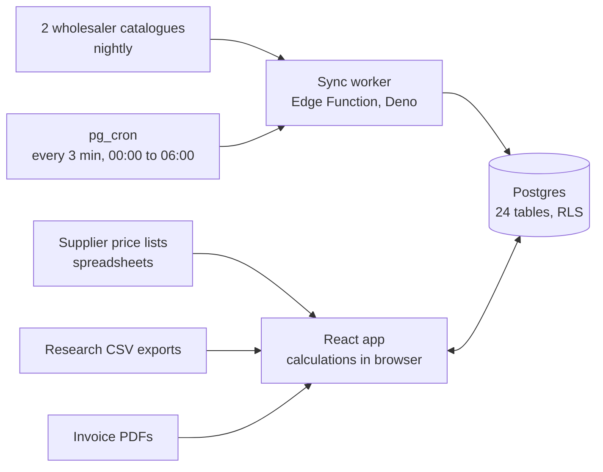

# Ecommerce Operations Platform (Case Study)

An internal pricing, purchasing and product research platform running in production for a UK Amazon wholesale seller. The source code is private because it belongs to the business, so this repository is a technical case study of how it works and why it was designed this way.

**Stack:** React, Vite, Tailwind, Supabase (Postgres, Auth, Storage, Edge Functions), Deno, pg_cron, Vercel

**At a glance**

- In production since June 2026, used daily by a small team (5 accounts)
- 24 Postgres tables, ~58,000 rows, row-level security on every table (27 policies)
- 48,020-row supplier catalogue kept up to date by a nightly sync (1,500+ recorded runs)
- 22 modules covering margin calculation, product research, purchasing, invoice reading and approvals
- 45 automated tests on the core logic, including 11 real supplier invoices as fixtures

## The problem

A wholesale seller needs to know, for every product, whether it can be bought from a supplier and resold at a profit after marketplace fees, shipping, packaging, VAT and advertising. It also needs to raise purchase orders from supplier invoices and keep costs current as suppliers change prices. Mistakes are silent: a wrong cost or a mismatched product produces a confident but wrong margin, and money gets spent on it.

## Architecture

- There is no separate backend. The browser talks to Postgres through Supabase's generated API, and row-level security is the authorisation layer.
- Calculations run in the browser, with all domain logic kept in pure functions separate from the UI so it can be tested.
- Privileged actions (creating accounts, setting passwords) run in an Edge Function that checks the caller is an admin before using the service key, so that key never reaches the browser.
- Invoices sit in a private storage bucket behind 30-minute signed URLs.

## Key decisions

**1. Break-even price by binary search**

The marketplace referral fee is a percentage of the sell price and also steps up at category thresholds, so profit as a function of price is piecewise and cannot be rearranged to solve for break-even. The solver binary searches over price, recomputing the full cost stack at each step, with the fee thresholds passed in so it doesn't stall on a discontinuity. The closed-form approximation it replaced was out by roughly 10% on stepped categories.

**2. Matching that prefers precision over recall**

Research exports have to be matched to products in the 48k-row supplier catalogue, often without barcodes. A wrong match is worse than no match, because it produces a believable but false margin. Matching cascades through barcode, then supplier code, then structural name rules: every meaningful word must appear, model numbers and pack sizes must agree, refills never match the device, and mixed bundles are flagged rather than matched. Fuzzy string distance was deliberately rejected because its near-misses fail silently. Human confirmations are stored and always win afterwards.

**3. Resumable, polite catalogue sync**

Serverless functions have short execution limits, and the catalogue is tens of thousands of rows. Each run processes a small slice, saves a cursor, and exits; pg_cron restarts it every 3 minutes overnight and it resumes where it stopped. It makes one request at a time with delays, a nightly cap per supplier and back-off when a site is busy. Every run is logged for observability. One supplier site blocks automated reading, so it is marked manual rather than worked around.

**4. Invoice reading that assumes it will be wrong**

Supplier PDFs are turned into purchase orders in the browser, with a reader per supplier layout and a general fallback. Three independent checks run on every document: net plus VAT against the total, line items against the goods figure, and order total against document total. An order that disagrees with its invoice cannot be sent for payment. The most robust reader works from numeric tokens rather than column positions, after one layout variation dropped 5 of 13 lines.

**5. Safe concurrent editing**

Several people edit the same records. Writes carry a version number, and a stale write raises a conflict that is shown to the user instead of silently overwriting someone else's change. Machine-generated suggestions (a cheaper supplier, a cost change, a wrong fee category) go into an approval queue with deduplication keys, and approving a cost change cascades to every listing built on that product.

## Results

- Four months of daily production use, with 53 purchase orders and real money flowing through them
- Security moved from fully open tables to row-level security across all 24 tables, verified by testing anonymous, member, deactivated and admin access
- Every action is recorded in an audit trail with who did it and what changed

## What I'd improve

- Split the main application shell (2,000+ lines) into domain modules
- Move section-level permissions from the client into the database
- Replace the JSON listing blob with proper columns for its stable fields
- Add CI so tests run on every deploy, plus UI and integration tests

## My role

I designed and run this platform end to end: the requirements, architecture and product decisions, the engineering standards, production use with the team, and the testing that caught most of its defects. I use AI coding tools as a core part of my workflow, which is what made it possible to ship a production system of this scope on my own, with every design decision and fix going through me.
